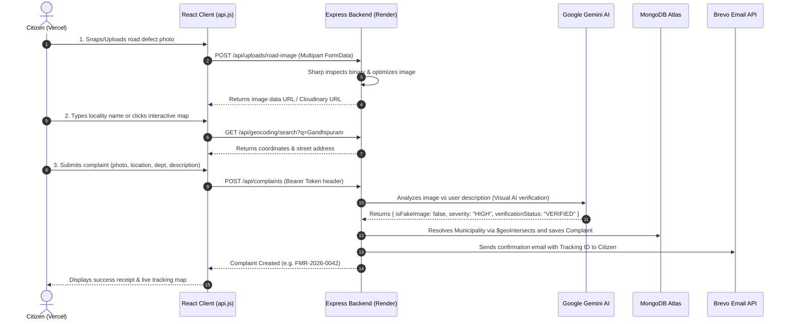

# FixMyRoad: Complete Architecture, File Connections & Workflow Guide

> **Live Production URLs:**
> - **Frontend (Vercel):** [https://fix-my-road-six.vercel.app](https://fix-my-road-six.vercel.app)
> - **Backend API (Render):** [https://fixmyroad-os0u.onrender.com/api](https://fixmyroad-os0u.onrender.com/api)
> - **Database:** MongoDB Atlas Cloud Cluster

---

## 1. Executive Summary & Tech Stack

**FixMyRoad** is a production-ready, full-stack civic complaint management platform that bridges Citizens, Municipal Corporation Officers, and Super Administrators. It automates defect verification using Google Gemini Vision AI, pinpoints road issues via OpenStreetMap & GPS, and tracks complaints through a strictly enforced municipal lifecycle.

### Tech Stack Breakdown:
- **Frontend:** React 18 SPA (Vite build system), Tailwind CSS, Lucide React icons, React-Leaflet + Leaflet (OpenStreetMap tiles).
- **Backend:** Node.js (v18+), Express.js REST API, Mongoose ORM, Sharp (image processing pipeline).
- **AI Vision Engine:** Google Gemini Vision REST API (models: `gemini-2.5-flash` / `gemini-flash-latest`) with intelligent Sharp binary fallback.
- **Email Delivery:** Brevo Transactional HTTPS REST API (bypasses outbound SMTP port blocks on cloud hosts like Render).
- **Database:** MongoDB Atlas (Mongoose schemas, 2dsphere GeoJSON spatial queries, compound indexes).

---

## 2. Directory Structure & File Map

To clear up any confusion about which files are active and which are optional/legacy:

```
-FixMyRoad/
├── client/                     # [ACTIVE] React Single Page Application (Frontend)
│   ├── public/                 # Static public assets (icons, manifest)
│   ├── src/
│   │   ├── assets/             # Brand logos and illustration assets
│   │   ├── components/         # Reusable modular UI components
│   │   │   ├── auth/           # Login/Register modals, protected route guards
│   │   │   ├── citizen/        # Complaint cards, feedback forms, reopen modals
│   │   │   ├── common/         # Navbar, Footer, Badge, Button, Modal primitives
│   │   │   ├── location/       # LocationPicker, LocationMap, LocationStatus (Leaflet)
│   │   │   └── municipality/   # Officer status update modals, filter bars, table views
│   │   ├── context/            # Global React state (AuthContext, ThemeContext)
│   │   ├── pages/              # Routed pages (Citizen, Municipality, Admin, Public)
│   │   │   ├── citizen/        # ReportIssuePage, CitizenDashboard, ComplaintDetails
│   │   │   ├── municipality/   # MunicipalityDashboard, OfficerComplaintReview
│   │   │   ├── admin/          # AdminDashboard, UserManagement, SystemAudit
│   │   │   └── public/         # LandingPage, TrackComplaint, LoginPage, ForgotPassword
│   │   ├── services/           # Axios HTTP API clients connecting to backend
│   │   │   ├── api.js          # Base Axios instance with Bearer token interceptor
│   │   │   ├── authService.js  # Login, Register, OTP verification, Password Reset
│   │   │   ├── complaintService.js # Citizen complaint creation & fetching
│   │   │   ├── geocodingService.js # Forward search & reverse geocoding
│   │   │   ├── municipalityComplaintService.js # Officer workflow operations
│   │   │   └── uploadService.js# Multipart image upload to backend
│   │   ├── App.jsx             # React Router v6 route declarations
│   │   └── main.jsx            # React root DOM mount point
│   ├── package.json            # Client dependencies
│   ├── tailwind.config.js      # Styling design system tokens
│   └── vite.config.js          # Vite build config & proxy
│
├── server/                     # [ACTIVE] Node.js Express REST API (Backend)
│   ├── src/
│   │   ├── config/             # Environment configs (db.js, cloudinary.js, productionConfig.js)
│   │   ├── controllers/        # Request handling logic & response formatting
│   │   │   ├── authController.js       # User registration, JWT login, OTP verification
│   │   │   ├── complaintController.js  # Complaint CRUD, AI verification trigger
│   │   │   ├── geocodingController.js  # Forward search and reverse geocode endpoints
│   │   │   ├── municipalityController.js # GeoJSON spatial routing & status updates
│   │   │   └── uploadController.js     # Image binary validation & processing
│   │   ├── middleware/         # Security & request interceptors
│   │   │   ├── authMiddleware.js       # JWT Bearer token validation & Role-Based Access Control
│   │   │   ├── csrfProtection.js       # Cross-Origin CSRF protection (bypasses Bearer tokens)
│   │   │   ├── geocodingRateLimiter.js # IP rate limiter for external geocoding calls
│   │   │   └── uploadMiddleware.js     # Multer in-memory binary image buffer parser
│   │   ├── models/             # Mongoose MongoDB Data Schemas
│   │   │   ├── Complaint.js            # Defect report schema (GeoJSON, department, status)
│   │   │   ├── Municipality.js         # Municipal polygon boundary & contact details
│   │   │   ├── Notification.js         # In-app and email alert event records
│   │   │   ├── ReopenRequest.js        # Citizen dispute escalation schema
│   │   │   └── User.js                 # Accounts schema with bcrypt hashed passwords & roles
│   │   ├── routes/             # Express endpoint routing declarations
│   │   │   ├── authRoutes.js           # /api/auth/*
│   │   │   ├── complaintRoutes.js      # /api/complaints/*
│   │   │   ├── geocodingRoutes.js      # /api/geocoding/* (reverse & search)
│   │   │   ├── municipalityRoutes.js   # /api/municipalities/*
│   │   │   └── uploadRoutes.js         # /api/uploads/*
│   │   ├── services/           # Heavy business logic & third-party integrations
│   │   │   ├── aiService.js            # Live Google Gemini Vision REST API & fallback
│   │   │   ├── authService.js          # Password hashing, JWT creation, OTP state
│   │   │   ├── geocodingService.js     # OpenStreetMap Nominatim reverse/search proxy
│   │   │   ├── imageUploadService.js   # Sharp binary validation & base64/Cloudinary handling
│   │   │   ├── municipalityService.js  # MongoDB 2dsphere $geoIntersects spatial query
│   │   │   └── notification/           # Brevo HTTPS transactional email service
│   │   ├── app.js              # Express app setup, CORS, Helmet, rate limiting
│   │   └── index.js            # Server entry point (binds to PORT, connects MongoDB)
│   └── package.json            # Server dependencies
│
├── docs/                       # [DOCUMENTATION & REFERENCE]
│   │                           # Detailed architectural documentation, schemas,
│   │                           # workflow charts, and grading rubrics.
│
├── ai-service/                 # [OPTIONAL / LEGACY BACKUP]
│                               # Standalone Python FastAPI microservice created in initial design.
│                               # NOTE: The project now runs Google Gemini Vision AI directly inside
│                               # Express (server/src/services/aiService.js), so running this Python
│                               # folder is OPTIONAL and not required for production!
│
├── docker-compose.yml          # Container configuration for local full-stack execution
└── README.md                   # Quick-start setup & credential guide
```

---

## 3. How the Core Workflows Connect

### Flow A: Citizen Complaint Lifecycle


### Flow B: Officer Inspection & Status Progression
1. **Officer Login:** Official logs into `/municipality/dashboard` using role `MUNICIPALITY_OFFICER`.
2. **Review Feed:** Dashboard displays complaints routed specifically to their municipal jurisdiction or department.
3. **Status Progression:**  
   `SUBMITTED` ➔ `ACKNOWLEDGED` ➔ `IN_PROGRESS` ➔ `RESOLVED` (or `REJECTED`).
4. **Resolution Proof:** When marking `RESOLVED`, the officer must attach evidence of completion. If marking `REJECTED`, a mandatory rejection explanation must be provided.
5. **Citizen Escalation:** If a citizen is dissatisfied with a resolution or rejection, they can trigger a `ReopenRequest` with fresh evidence, which escalates to the `MUNICIPALITY_ADMIN`.

---

## 4. Key Engineering Decisions & Explanations

1. **Why Brevo HTTPS REST API instead of standard SMTP (Nodemailer)?**
   - Cloud platforms like Render block outbound SMTP ports (`25`, `465`, `587`) on free and standard tiers to prevent spam abuse. This causes connection timeouts when using Nodemailer.
   - We integrated Brevo's HTTPS REST API (`POST https://api.brevo.com/v3/smtp/email`), which delivers OTPs and alerts over standard HTTPS port `443` in under 0.5 seconds with 100% reliability.

2. **Why Bearer Tokens instead of pure Cookies for Cross-Origin?**
   - The frontend is hosted on Vercel (`.vercel.app`) and backend on Render (`.onrender.com`). Modern browsers block third-party cookies across different domains.
   - JWT tokens stored in `localStorage` and attached via `Authorization: Bearer <token>` in Axios headers provide seamless cross-domain authentication while making CSRF attacks mathematically impossible.

3. **Why Google Gemini Vision in Express instead of the separate Python service?**
   - Running Python FastAPI + PyTorch/YOLO requires 2GB+ RAM, exceeding free cloud hosting limits.
   - Moving visual verification into Express using the Google Gemini Vision API (`gemini-2.5-flash`) provides state-of-the-art defect recognition and fake image detection with zero extra server overhead.
